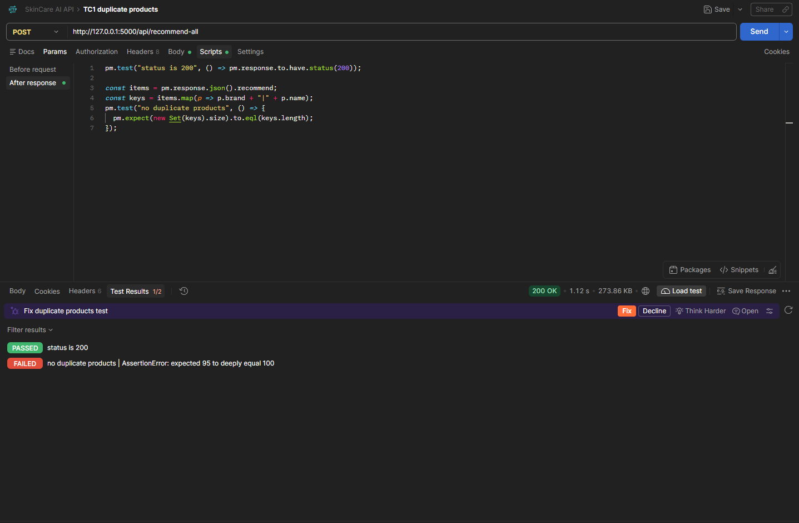

# Bug Reports — SkinCare AI

ทดสอบเมื่อ: 2026-10-16
สภาพแวดล้อม: Windows, Python 3.13, backend รันในเครื่องที่ `http://127.0.0.1:5000`
ผล pytest รอบล่าสุด (2026-10-16): ผ่าน 6, xfail 8 (BUG-001 จำนวน 5, BUG-002 จำนวน 3)

---

## BUG-001: สินค้า brand + name เดียวกันปรากฏหลายครั้งในรายการแนะนำ (ต้นเหตุอยู่ที่ข้อมูล)

- **Endpoint:** `POST /api/recommend-all`
- **Severity:** Low–Medium | **Priority:** Low
- **สถานะ:** Open — ยืนยันต้นเหตุระดับข้อมูลแล้ว

**Steps to reproduce:** ส่ง request ของ TC1 (Postman: `TC1 duplicate products` หรือ `pytest -k test_no_duplicate_products`) แล้วนับสินค้าใน `recommend` ที่ brand + name เหมือนกัน

**Expected:** ผู้ใช้แยกสินค้าแต่ละชิ้นออกจากกันได้
**Actual:** TC1 ได้ 100 รายการ มี 5 กลุ่มที่ brand + name เหมือนกัน (5 เคสที่ทดสอบพบ 1–5 กลุ่ม)

**ผลตรวจฐานข้อมูล (5,299 แถว):**
- 117 กลุ่ม brand + name มีมากกว่า 1 แถว (ส่วนเกิน 132 แถว)
- ในนั้น 143 คู่ส่วนผสมต่างกัน (คนละสูตร เช่น Whitelab "Acne Toner" id 5158/5159) และ 7 คู่ส่วนผสมเหมือนกัน (ดู BUG-004)
- engine ทำงานตามข้อมูลที่มี ไม่ได้ส่งแถวเดียวกันซ้ำ

**ผลกระทบ:** ผู้ใช้เห็นรายการที่ดูเหมือนซ้ำ เพราะ response ไม่มี `id` หรือตัวแยกอื่น
**ข้อเสนอแนะ:** เพิ่ม `id` (หรือ product_url) ใน response และแสดงตัวแยกในหน้าเว็บ อย่าตัดแถวด้วย brand + name เพราะส่วนใหญ่เป็นคนละสูตร
**หลักฐาน:** 

---

## BUG-003: ตาราง products มีแถวซ้ำทุกค่า และไม่มี unique constraint บน product_url

- **Severity:** Low | **Priority:** Low
- **สถานะ:** Open

**พบจาก:** `SELECT product_url, COUNT(*) FROM products GROUP BY product_url HAVING COUNT(*) > 1;`
**Actual:** `…/bath-and-body-works-revitalizing-cucumber-face-mask` มี 2 แถว (id 517, 518) ราคา 350, skintype dry, `created_at` และ hash ส่วนผสมเหมือนกัน ต่างแค่ id (ซ้ำ 1 กลุ่มจาก 5,299 แถว)
**Expected:** 1 แถวต่อ 1 URL

**สาเหตุ:** `pg_indexes` ของตาราง `products` มี index เดียวคือ `products_pkey` (บน `id`) ไม่มี unique index บน `product_url` ฐานข้อมูลไม่ป้องกันข้อมูลซ้ำ
**ข้อเสนอแนะ:** ลบแถวซ้ำ แล้วเพิ่ม unique constraint บน `product_url` และเช็กว่า `ON CONFLICT` ของ upsert ใช้คอลัมน์เดียวกัน

---

## BUG-004: สินค้าเดียวกันถูกเก็บ 2 แถวจาก URL คนละหน้า (`-2`) ส่วนผสมเหมือนกันทุกตัว

- **Severity:** Low–Medium | **Priority:** Low
- **สถานะ:** Open

**พบจาก:** เทียบ `ingredients_list` ของคู่ที่ brand + name เดียวกัน พบ 7 คู่ที่เหมือนกันทุกตัว (จาก 150 คู่)
**ตัวอย่างที่ยืนยันแล้ว (hash ส่วนผสมตรงกัน ราคาและ skintype เท่ากัน):**
- The Skin Collection "Exfoliating Toner": id 4827 / 4828
- Uncle Tony "Under Eye Cream": id 4954 / 4955

**Expected:** 1 แถวต่อ 1 สินค้า
**Actual:** 2 แถว คนละ `product_url` (ลงท้าย `-2`) ทำให้ปรากฏซ้ำในรายการแนะนำ
**สาเหตุที่เป็นไปได้:** การ scrape เก็บทุกหน้าที่ INCIDecoder ใช้ชื่อเดียวกัน โดยไม่เทียบเนื้อหา
**ข้อเสนอแนะ:** ใช้ brand + name + hash ของส่วนผสมเป็นเกณฑ์ลบข้อมูลซ้ำ (ไม่ใช่แค่ brand + name)

---

## OBS-001: Response ไม่มี product id (ข้อสังเกต)

fields ที่ได้: brand, explanation, final_score, function_tags, image_url, major_category, name, price, skintype, subtype
แยกสินค้าซ้ำจริงออกจากสินค้าคนละรุ่นที่ชื่อเดียวกันไม่ได้ จึงเช็กซ้ำได้แค่ brand + name ข้อเสนอ: เพิ่ม `id` ใน response

## OBS-002: รายการส่วนผสมในฐานข้อมูลมีค่าซ้ำจำนวนมาก (ข้อสังเกต)

ตัวอย่างแถว id 5158 (Whitelab "Acne Toner"): Niacinamide ปรากฏ 6 ครั้ง, Salicylic Acid 6 ครั้ง, Aqua 2 ครั้ง ใน `ingredients_raw` / `ingredients_list` อาจเกิดจากการต่อข้อมูลหลายส่วนของหน้าเว็บตอน scrape ยังไม่ได้ตรวจว่ากระทบคะแนนแนะนำหรือไม่